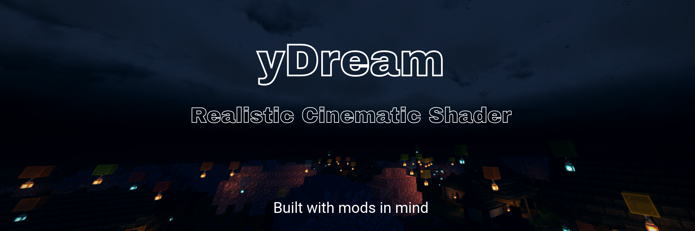
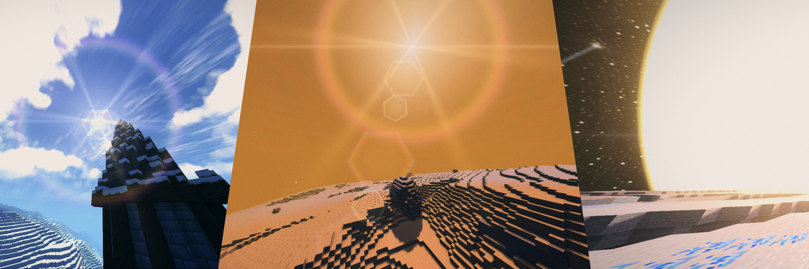
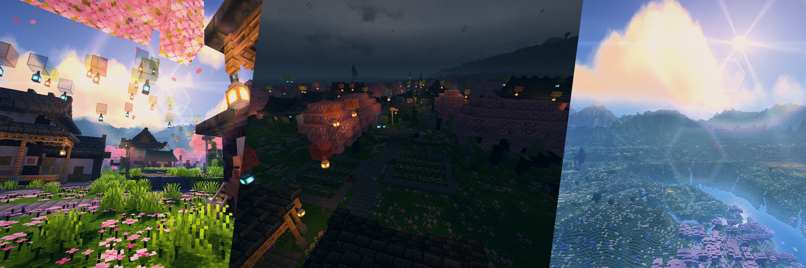

  

  <h1>yDream Shaders</h1>

  
<strong>Ad Astra Per Aspera.</strong>

  

    A cinematic, highly customizable visual experience for Minecraft. 
    Explore new skies, dynamic lighting, volumetric clouds and planetary atmospheres —
    without needing a high-end GPU.
  

  

    
    
    
  

  

    
    
  

  

    
    
    
    
  

  

    
  

  

    
  

## Overview

**yDream Shaders** is a cinematic, highly customizable Minecraft shader pack built for **Iris 1.8.1+** and **OptiFine**. It is tested on **Minecraft 1.21.1 with NeoForge** and is designed with **Create Aeronautics** in mind.

Built upon the fast rendering core of [MakeUp UltraFast](https://github.com/javiergcim/MakeUpUltraFast), yDream extends it with custom visual systems and atmospheric features. It also builds on [Gleam Shaders](https://modrinth.com/mod/gleam-shaders), with credits to its [original creator](https://modrinth.com/user/FihMC).

---

## Requirements

| Component | Version |
|-----------|---------|
| Minecraft | 1.21.1 |
| Loader (tested) | NeoForge |
| Shader loader | Iris **1.8.1+** or OptiFine |
| GPU (reference) | GTX 750 Ti |

> All screenshots were captured on a **GTX 750 Ti**. The pack is optimized to run on modest hardware.

---

## Cinematic Experience

yDream has one cohesive style — but it's extremely customizable.

**Ten color schemes** shift the entire palette (sky, light, sunsets, night, aurora):

- Golden Hour
- Arctic
- Neon Dusk
- Crimson Ember
- Pastel Dream
- Tropical Lagoon
- Violet Twilight
- Misty Forest
- Desert Gold
- Midnight Blue

Choose **Style default** to keep the shader's original palette.

---

### Real Star Catalog

Instead of procedurally generated stars, yDream can render the actual night sky using the [HYG astronomical catalog](https://github.com/astronexus/HYG-Database) and the [IAU constellation lines](https://www.iau.org/IAU/Astronomy-FAQs/Constellations.aspx). Orion, the Big Dipper, Cassiopeia, the Southern Cross and 16 other famous constellations are drawn from real celestial coordinates, so they look the way they do from Earth.

The catalog covers the **500 brightest stars** (down to magnitude ~4) with accurate positions and apparent brightness.

---

## Compatibility

> Nerdy stuff ahead.

### Distant Horizons
- LOD depth participates in **fog** and **volumetric-cloud occlusion**, so clouds are clipped by distant terrain instead of appearing behind it.
- DH water is correctly hidden under the cloud deck.
- TAA reprojection accounts for DH depth.
- LOD terrain recomputes per-face normals and can receive the shadow map within a configurable distance — the hand-off between real chunks and LODs is much harder to spot.
- **Color-match option** desaturates and dims the flat DH palette to approach textured terrain.

### Northstar planets (requires the Northstar mod)
Each of Mercury, Venus, Mars, the Moon and the orbital dimensions has its own atmosphere preset, sky colors, haze and sun size.

- **Moon** — sky colors, haze, neutral sunlight and a small shadow floor.
- **Mars** — tawny dust-haze sky with a blue aureole around the sun; adjustable dust optical depth and daylight strength; stars low on the horizon are dimmed by dust.
- **Venus** — dense, amber, cloud-filtered sky with a diffuse solar glow; adjustable cloud opacity and warm ground light.
- **Mercury** — very large apparent sun, with its own sky colors and haze.
- **Orbit** — planets and the sun drawn with their correct brightness from the NASA solar flux values; sun size scales with orbital distance; planet brightness and maximum brightness adjustable.

> Each planet can show or hide Northstar suns and clouds independently, and planet atmosphere presets can be turned off entirely.

---

## Performance

**Performance mode** trades a little detail for frame rate:

| Mode | Description |
|------|-------------|
| **Quality** | Full ray steps |
| **Balanced** | Moderate ray steps |
| **Fast** *(default)* | Reduced ray steps for clouds, reflections, godrays and AO |
| **Max FPS** | Maximum reduction for high refresh-rate play |

Fine-tuning sliders control cloud, godray, reflection and ambient occlusion detail, along with shadow quality and distance. Heavy experimental features (sun bounce light, global illumination) live under **Experimental** and cost extra frame rate.

**Anti-aliasing options:** temporal TAA/ATAA and SMAA 1x / T2x. SMAA uses standard lookup textures and fullscreen passes.

> Simple benchmarks show a **5%–10% performance improvement** compared to Gleam using the *Polished* and *default* presets.

---

## Dimensions

### Overworld
Everything described above.

### The Nether
- Ember-filled atmosphere with adjustable fog distance.
- Drifting embers with amount and color modes: **fire orange**, **soul blue**, **crimson**, **warped teal** or **golden**.
- Glowing haze and adjustable star brightness.
- Nether clouds follow the same volumetric cloud settings as the overworld.
- Uses the overworld star layer.

### The End (Lore for my ModPack, you can disable)
A self-contained End atmosphere with:

- **Three sky palettes:** Molten Dusk, Violet Abyss, Ash and Ember.
- Sky depth, horizon glow, vertical heat.
- A **planetary core** you can toggle on/off:
  - Three palettes: Molten Orange, Bright Magma, Deep Mantle.
  - Adjustable size and intensity.
  - Optional purple corruption lines (with count and palette).
  - Warm scene light.

---

# Credits & Licenses

yDream Shaders is built on the **MakeUp UltraFast** codebase by Javier Garduño ([github.com/javiergcim/MakeUpUltraFast](https://github.com/javiergcim/MakeUpUltraFast)), distributed under the GNU Lesser General Public License v3.0. The base architecture and several lower-level techniques come from that project.

Some of the code is inspired by work from:

## Astronomy data
- **HYG Database v4.1** — David Nash (AstroNexus). CC BY-SA 4.0.
  Source: https://github.com/astronexus/HYG-Database
  Modified: filtered to 500 brightest stars; RA/Dec converted to 3D vectors.

- **d3-celestial constellation lines** — Olaf Frohn. BSD-3-Clause.
  Source: https://github.com/ofrohn/d3-celestial

- **IAU constellation stick figures** — Alan MacRobert et al. CC BY 4.0.
  Source: https://www.iau.org/public/themes/constellations/

## Algorithms & code
- **Dave Hoskins — “Hash without Sine”** — MIT License.
  Source: https://www.shadertoy.com/view/4djSRW

- **SMAA** — Jorge Jimenez, Jose I. Echevarria, Belen Masia,
  Fernando Navarro, Diego Gutierrez. MIT License.
  Source: https://github.com/iryoku/smaa

## Academic references (conceptual)
- Brian Karis, “High Quality Temporal Supersampling”, SIGGRAPH 2014.

- Lasse Jon Fuglsang Pedersen, “Temporal Reprojection Anti-Aliasing in INSIDE”, GDC 2016.
> The temporal anti-aliasing resolve is conceptually based on Brian Karis’ “High Quality Temporal Supersampling” (SIGGRAPH 2014) and Lasse Jon Fuglsang Pedersen’s “Temporal Reprojection Anti-Aliasing in INSIDE” (GDC 2016). Implementation, reprojection, AABB clipping and age handling were written for yDream.

---
- Andrew Schneider & Nathan Vos, “The Real-Time Volumetric Cloudscapes of Horizon: Zero Dawn”, SIGGRAPH 2015.
- Sébastien Hillaire, “Physically Based Sky, Atmosphere & Cloud Rendering in Frostbite”, SIGGRAPH 2016.
> The volumetric cloud raymarch, erosion and multi-scatter lighting are inspired by Schneider & Vos (Horizon: Zero Dawn, SIGGRAPH 2015) and Sébastien Hillaire (Frostbite, SIGGRAPH 2016). The cloud-shadow projection and LOD occlusion were implemented specifically for yDream.

## Base codebase
- MakeUp UltraFast (see original project license).
- Gleam
---

## License & Usage

You can **use, modify and share** yDream under the **GNU Lesser General Public License v3.0** (see [`LICENSE`](LICENSE)), the same license MakeUp UltraFast uses.

If you redistribute it, please **keep the credit** to MakeUp UltraFast and Javier Garduño. You don't need to ask first — though I'd love to hear about it!

<strong>どんなマイクでも構いません！</strong>
